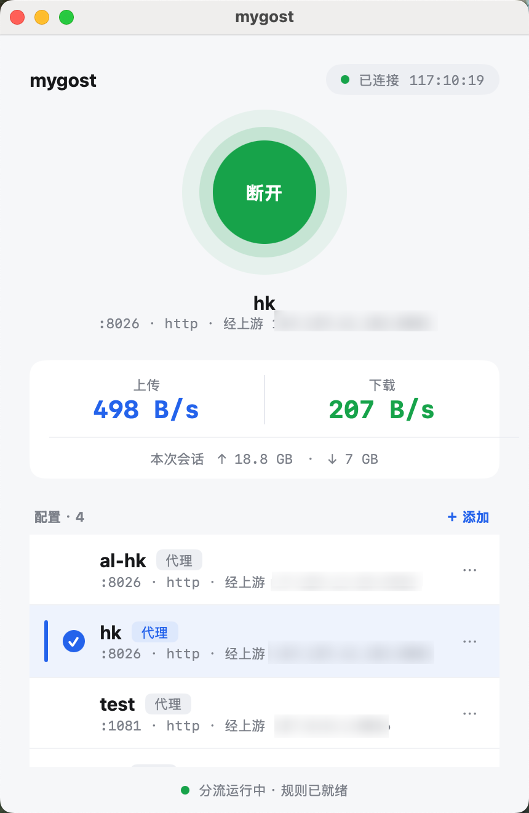

# mygost

[gost](https://github.com/go-gost/gost) 的桌面客户端。纯 Go 原生 UI（[MyGo](https://mygo.egoist.dev)，无 webview），管理本机 gost 进程。



## 功能

**配置** — 三种类型，表单直接生成 gost.yml：

| 类型 | 说明 |
|---|---|
| 代理 | http / socks5 / relay，可选认证与上游转发链（任意 connector） |
| 端口转发 | tcp / udp，多目标即负载均衡 |
| 自定义 YAML | 内置代码编辑器，完整 gost 能力 |

**运行** — 一键连接当前配置，实时速率与本次会话流量；停止走优雅信号（2s 后强杀），异常退出原因直接显示；托盘图标反映状态，可快速切换配置。

**分流** — 开启「国内直连」后按主流客户端方式分层判定：IP 查 CN IP 表，域名查 CN 域名表（11 万条后缀），未收录默认走代理。直连由本机解析（就近 CDN），代理由上游解析（避开 DNS 污染）。

**请求记录** — 每个请求的去向（直连 / 代理 / 失败）、节点与失败原因；按天落盘，保留 7 天，可回看历史。

**连通性测试** — 只走当前配置的本地代理端口，不受系统代理与环境变量影响。

**日志** — 环形缓冲、关键词过滤、原始日志与请求视图切换。

## 开箱即用

安装包已内置 gost 与分流插件，无需额外安装。首次启动自动解压到数据目录；也可在设置里手动指定 gost 路径或下载指定版本（sha256 校验，支持镜像模板与系统代理）。

## 安装

从 [Releases](https://github.com/pingfury108/mygost/releases) 下载：

- macOS：`mygost-<version>-arm64.dmg`（Apple Silicon）或 `-amd64.dmg`（Intel）
- Windows：`mygost-setup-<version>-amd64.exe`

> macOS 产物为 ad-hoc 签名、未公证，首次打开需在「系统设置 → 隐私与安全性」里放行。

## 开发

```bash
./tools/fetch-deps.sh   # 生成要嵌入的 gost 与分流插件（二进制不入库）
go tool mygo dev        # 运行，改 .go 自动重启
CGO_ENABLED=0 go test ./...
go tool mygo vet .
```

打包：

```bash
go tool mygo build -platform "darwin/amd64,darwin/arm64,windows/amd64"
```

产物在 `build/<os>-<arch>/`。推 tag `v*` 会触发 CI：测试 → 构建三平台 → 建 Release 上传安装包。发布前把 `mygo.json` 的 `version` 改成与 tag 一致。

## 数据目录

| 平台 | 路径 |
|---|---|
| macOS | `~/Library/Application Support/mygost` |
| Windows | `%APPDATA%\mygost` |

开发版（`mygo dev`）自动用 `mygost-dev`，与正式版完全隔离（配置、进程、规则各管各的）。

## 目录结构

```
main.go               应用状态、窗口、生命周期
view_*.go             各页面（只读渲染）
theme.go              设计 token 与主题
split_supervisor.go   分流插件的唯一管理者
view_state.go         后台探测 → 视图状态（渲染路径零 syscall）
request_feed.go       日志解析接线与落盘
internal/proc/        gost 子进程托管、进程识别（跨平台）
internal/profiles/    配置档存储 + gost.yml 生成
internal/gostbin/     gost 定位、下载、嵌入
internal/splitd/      分流判定引擎 + gRPC 插件
internal/reqlog/      请求记录解析与按天持久化
internal/metrics/     Prometheus 抓取、速率、按天流量
internal/probe/       连通性测试
cmd/splitd/           分流插件可执行程序
tools/fetch-deps.sh   生成嵌入用的 gost 与 splitd
```
